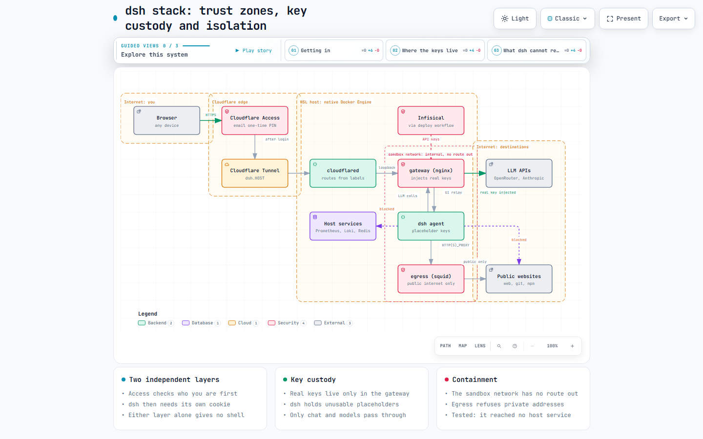

# DeepSeek Harness (dsh)

Self-hosted AI agent harness ([deepseek-ai/deepseek-harness](https://github.com/deepseek-ai/deepseek-harness), developer preview) that runs model-generated commands. It is treated as untrusted: pinned npm release, isolated network, keys it cannot read. The reasoning and what was verified are in [ADR 004](../../../docs/adrs/004-dsh-isolation-and-access.md).

## Architecture



Interactive version: [`dsh-stack-trust-zones.html`](../../../docs/diagrams/dsh-stack-trust-zones.html).

| Service | Image | Role |
|---|---|---|
| `dsh` | `systems-playground-dsh` | The harness. Holds only placeholder keys. Non-root, read-only rootfs, no capabilities. Attached only to the internal `sandbox` network. |
| `gateway` | `systems-playground-dsh-gateway` | nginx. The sole published port (`127.0.0.1:3080`). Relays the UI to `dsh`, and is dsh's LLM endpoint: it injects the real OpenRouter/Anthropic key, verifies the upstream certificate, and forwards only the chat and models endpoints. |
| `litellm`, `litellm-db` | `ghcr.io/berriai/litellm` (pinned), `postgres:16-alpine` | The MCP hub (see [MCP tools](#mcp-tools-litellm-hub)). Holds the tokens for tools like GitHub; dsh holds one scoped key. The admin UI is loopback only. |
| `egress` | `systems-playground-dsh-egress` | squid. The agent's only route to the public internet (ports 80/443, for web, git and npm). Refuses loopback, RFC 1918, link-local and CGNAT destinations: the host, the LAN, every other stack's published ports. |

**Why the split.** A process running as the same user can read another's environment from `/proc`, so any key placed in `dsh` is readable by the agent, even though dsh scrubs credential-named variables for the commands it spawns. Keys therefore live only in the gateway. And a normal container can reach every service published on the host, so `dsh` sits on a network with no route out at all. Model-authored scripts that ignore the proxy variables simply have no route.

## Run locally

```bash
cp .env.example .env        # add OPENROUTER_API_KEY and/or ANTHROPIC_API_KEY
docker compose up -d --build
sh link.sh                  # launch URL
```

Open the launch URL once per browser; it is exchanged for a 30-day session cookie. `settings.seed.yaml` registers OpenRouter (`deepseek/deepseek-v4-flash-0731`) and Anthropic (`claude-sonnet-5`, `claude-haiku-4-5-20251001`) against the gateway. It is copied only into an empty `dsh_home` volume; on an existing volume change providers in Settings → Models.

## Deploy

`build-infra-dsh.yml` builds the three images into the self-hosted registry; `deploy-infra-dsh.yml` then pulls them to `$INFRA_BASE_DIR/dsh` with secrets from Infisical (`prod`): `OPENROUTER_API_KEY` and/or `ANTHROPIC_API_KEY`, plus the shared `REGISTRY_*` ones. Use dedicated keys with spend limits.

- **Boot.** The workflow installs the file as `compose.yml`, not `docker-compose.yml`, on purpose: `wsl-startup.sh` runs a bare `docker compose up -d` on every `*/docker-compose.yml`, which would recreate the gateway with blank keys. Under this name the boot script skips it and `restart: unless-stopped` restores the existing containers. `docker compose stop` is the kill switch and survives a reboot.
- **Manual runs on the host** need the same environment. Use the workflow (or `infisical run -- docker compose up -d`); a bare `docker compose up -d` there blanks the keys.
- **Backups.** `wsl-backup.sh` discovers services by that same glob, so `dsh_home` (settings, session history) is not backed up.

## Going public (Cloudflare Access first)

Nothing is published until the `HOST` repository variable (your domain, e.g. `example.com`) is set, and dsh's hostname is `<DSH_SUBDOMAIN or dsh>.<HOST>`. Because setting `HOST` is what publishes it, do these in order:

1. **A login method.** Cloudflare dashboard → Zero Trust → Integrations → Identity providers. If *One-time PIN* is not listed, add it (new accounts no longer get it automatically).
2. **A policy (who may enter).** Zero Trust → Access controls → Policies → Add a policy. Action *Allow*, session duration 24 hours (deliberately shorter than dsh's 30-day cookie), *Include* your own email address only. Never add a *Bypass* policy.
3. **An application (what it protects).** Zero Trust → Access controls → Applications → Create new application → Self-hosted and private → Add public hostname. Domain `<HOST>`, subdomain `dsh`, no path. Attach the policy, enable *One-time PIN*, set the session duration, Create.
4. **HTTPS.** In the zone: SSL/TLS → Edge Certificates → *Always Use HTTPS*. dsh's cookie has no `Secure` flag, so it must only ever travel over HTTPS. This setting is zone-wide.
5. **Publish.** GitHub → Settings → Secrets and variables → Actions → *Variables* tab → set `HOST`, then run *Deploy Infra - dsh*. Within about 30 seconds `cloudflared-sync.sh` adds the route and the DNS record from the container label.
6. **Verify from outside.** An unauthenticated request must be redirected to your team's `cloudflareaccess.com` login, never reach dsh:

```bash
curl -sI https://dsh.<HOST>/ | grep -i -E "^HTTP|^location"
```

7. **Optional: make the tunnel verify Access too.** Access stamps every request it lets through with a signed token. Without this step nothing behind it checks the stamp, so if the Access application were deleted or mis-scoped, dsh's own cookie would be the only gate left. With it, `cloudflared` itself returns 403 for any request that lacks a valid token for this application.
   1. Copy the application's **Audience (AUD) tag**: Access controls → Applications → *Configure* on the dsh app → *Additional settings*. It is an identifier, not a secret.
   2. Set two more repository variables (both or neither): `CF_ACCESS_TEAM` (the `<team>` in `<team>.cloudflareaccess.com`) and `DSH_ACCESS_AUD` (the tag). Re-run *Deploy Infra - dsh*.
   3. `cloudflared-sync.sh` (deploy *Deploy Infra - Scripts* first if it has not run since this change) adds an `originRequest.access` block for the hostname. It validates the regenerated config with `cloudflared tunnel ingress validate` before installing it and keeps the old one if that fails. A half-set pair leaves the hostname unrouted with a warning in `~/infra/logs/cloudflared-sync.log`, rather than silently skipping the check.
   4. Check: `grep -B2 -A6 originRequest ~/.cloudflared/config.yml` shows the block, and signing in through Access still works. A request that bypasses Access can't be produced from outside to test the rejection; that part rests on cloudflared's own behaviour.

## Getting a launch link

dsh generates a new launch URL every time it starts (it is reusable until the next restart, not single-use), and you need one only for a new browser (or after the 30-day cookie expires). Two ways to get it:

- **On the host or from Windows:**

```bash
wsl -e bash -c "cd ~/infra/dsh && sh link.sh"
```

  It prints the public `https://` link when the stack is published, otherwise the loopback one. `sh link.sh local` forces the loopback link.
- **From anywhere (GitHub or Discord):** run the *dsh - Send Launch Link* workflow (Actions → Run workflow, from the website or mobile app). The link is posted to a private Discord channel and masked in the public run log. When dsh is published the message carries two links with the same token: the public one for any device, and a loopback one (`http://127.0.0.1:…`) that only works in a browser on the host machine, as the fallback for model and settings editing. It needs a Discord webhook URL stored in Infisical as `DSH_LINK_WEBHOOK_URL`.

Either way the link is a credential. It is useless without also passing Access, and it stops working when dsh next restarts (until then it can be reused), so keep the Discord channel private.

## MCP tools (LiteLLM hub)

dsh's own MCP client is installed but ships with no servers. Rather than putting tokens inside dsh (the agent can read anything in its own container, see ADR 004), one MCP hub holds them: [LiteLLM](https://docs.litellm.ai/docs/mcp). dsh gets a single entry pointing at `http://litellm:4000/mcp/` with a **virtual key that can only call MCP tools**. Adding GitHub, PostHog or anything else later is an admin-UI or API action, with no change to this repo.

**Before the next deploy**, add three secrets to Infisical (`prod`); the deploy fails without them: `LITELLM_MASTER_KEY` and `LITELLM_SALT_KEY` (both `sk-` plus `openssl rand -hex 32`) and `LITELLM_DB_PASSWORD`. The salt key encrypts the tokens stored in the database, so keep a copy: changing it makes them unreadable.

**Admin UI.** `http://localhost:4010/ui` on the host (user `admin`, password is the master key); from another machine use an SSH tunnel to `127.0.0.1:4010`. It is never routed through the tunnel.

**Sign-in.** Out of the box the UI accepts the shared master key as a password. Once you have created your own admin account (Users, then invite, and set its password through the invitation link), switch that shared login off. It is stored in the database, so it survives restarts, and the master key keeps working as an API key. Run on the host, after `infisical login` and `infisical init` once in this directory:

```bash
echo '{"general_settings":{"disable_env_credential_login":true}}' > /tmp/disable-env-login.json
infisical run --env=prod -- sh -c 'curl -s -X POST http://127.0.0.1:4010/config/update -H "Authorization: Bearer $LITELLM_MASTER_KEY" -H "Content-Type: application/json" -d @/tmp/disable-env-login.json'
```

Check your own account can sign in (private window) first. To undo, send the same request with `false`. Checked on a throwaway stack: the shared login stopped working at once and stayed off after a restart, and the master key still worked as an API key. A fresh database loses the setting, so repeat it after a rebuild.

**Add a tool server** (UI: *MCP Servers → Add New MCP Server*, or the API). Put the token in the server's bearer-token/credentials field, not in *static headers*: the admin API returns static header values in plain text.

```bash
curl -X POST http://127.0.0.1:4010/v1/mcp/server -H "Authorization: Bearer $LITELLM_MASTER_KEY" -H 'Content-Type: application/json'   -d '{"server_name":"github","url":"https://api.githubcopilot.com/mcp/","transport":"http","auth_type":"bearer_token","credentials":{"auth_value":"<fine-grained token>"},"allowed_tools":["search_code","get_file_contents"]}'
```

`allowed_tools` is enforced by the hub, so a tool outside it is hidden and refused even if called directly. Use a fine-grained, least-privilege token as well.

**Link dsh.** The deploy does this for you. Once dsh is up it runs `mcp-link.sh --restart` as a best-effort step: if dsh already holds a working hub key it changes nothing; otherwise it creates a key limited to MCP tools with tool search on. That key is granted no server of its own: dsh can use a server only if it is flagged "available to all keys" in the hub (a toggle on the server's form), or if you named it when running the script by hand. A server that is neither is invisible to dsh, writes dsh's MCP entry, revokes the old key and restarts dsh. A failure only prints a warning and never blocks the deploy: typical causes are that dsh has never started (run the deploy again), or that its MCP file holds hand-written entries, which the script refuses to overwrite.

Run it by hand to rotate the key, or to grant it named servers instead of relying on the "available to all keys" flag (this also replaces the current key):

```bash
cd ~/infra/dsh && infisical run --env=prod -- sh mcp-link.sh --rotate --restart github posthog
```

The key has tool search switched on, so dsh sees four small tools (`mcp_tool_search`, `mcp_tool_call`, and two for agents and skills) instead of every server's full tool list; the model searches, then calls what it found.

**Checked on a throwaway stack with fake secrets** (not on the live host): from the sandbox network dsh reaches `litellm` but not its database or the internet; the dsh key can use tools but gets 401/403 on adding servers, minting or listing keys; its server listing shows only the servers it was granted and no token values; a caller-supplied `x-mcp-<server>-authorization` header **replaces** the configured upstream token for that call, so rely on `allowed_tools`, per-key permissions and a scoped token, never on a header the hub injects.

**Publishing the admin UI** at `litellm.<HOST>` (or `LITELLM_SUBDOMAIN`). It is a full admin console, so it is routed only behind its own Cloudflare Access application, exactly like dsh: the hostname label stays empty until `LITELLM_ACCESS_AUD` is set, and with the AUD tag and `CF_ACCESS_TEAM` both set `cloudflared` rejects any request without a valid Access token. The tunnel carries the whole hub, so the hub's `/mcp` and API paths are behind the same gate. dsh itself still talks to the hub over the internal network.

1. Zero Trust, Access controls, Applications, Create new application, Self-hosted and private, add public hostname: your domain, subdomain `litellm`, no path. Attach your *Allow* policy (your email only, never *Bypass*) and enable *One-time PIN*.
2. Copy the application's Audience (AUD) tag (Configure, then Additional settings).
3. GitHub, Settings, Secrets and variables, Actions, *Variables*: set `LITELLM_ACCESS_AUD` to the tag (`HOST` and `CF_ACCESS_TEAM` are already set for dsh), then run *Deploy Infra - dsh*.
4. Check from outside: `curl -sI https://litellm.<HOST>/` must redirect to `cloudflareaccess.com`, never serve the UI.

Known gaps: the database (`litellm_db_data`) is not backed up, same as `dsh_home`; the hub uses about 650 MB of memory; LiteLLM is pinned and updates are manual.

## Auth model (checked against 0.1.5-rc.2)

- Every `/api` call needs a signed `HttpOnly; SameSite=Strict` cookie, minted by exchanging the launch token. The token rotates on every start and is accepted only at `GET /?token=`, not on API paths and not as a bearer.
- The cookie is bound to the hostname it was minted for and has no `Secure` flag. It is a bearer for 30 days: anyone holding it has a shell in the container.
- `/api` enforces a Host/Origin fence: loopback or `DSH_TRUSTED_HOSTS` (set from `HOST`) only; anything else gets 403.
- dsh refuses `--host 0.0.0.0`; `entrypoint.sh` forwards its port and the gateway is the only thing published.
- Revoke every session by deleting the `client-connection/browser-session` record in `.credentials.yaml` (in the `dsh_home` volume) and restarting.

## Editing models and settings from a public hostname

Upstream dsh enables host settings (Settings → Models, the provider directory, General) only when the page's own hostname is loopback. On a public hostname such as `dsh.<HOST>` it shows *Loading the provider directory failed: settings are unavailable in this browser*, and models cannot be created or edited. The restriction is in the browser client only; the server has no such check.

The image therefore patches those two client-side checks at build time (`patch-remote-settings.js`, run from the `Dockerfile`). Checked against a non-loopback hostname: the unpatched image reproduces the error, the patched one loads Settings → Models with the seeded providers, and a settings change made from that page is written to `settings.yaml`. Every request still has to pass Cloudflare Access, the trusted-host fence and dsh's session cookie, and the agent can already edit `settings.yaml` itself (same user, writable volume), so this removes no protection.

- **On a dsh upgrade** the patch fails the image build unless each expected line is present exactly once. Then review the new upstream code and update the script, or drop the patch if upstream has lifted the restriction.
- **Fallback if it ever stops working:** the loopback link. `sh link.sh local` prints it (from Windows: `wsl -e bash -c "cd ~/infra/dsh && sh link.sh local"`), and the *dsh - Send Launch Link* workflow includes it in the Discord message. Open it in a browser on the host machine. Settings are stored in the `dsh_home` volume, so they apply to every browser.

## Workspaces and uploads

The workspace picker browses the **server's** filesystem, so folders on your own device are not visible to it. Whatever the agent may touch is bind-mounted from `DSH_WORKSPACES_DIR` (default `./workspaces`, on the host `~/infra/dsh/workspaces`) at `/workspace`. Put or clone the repos you want worked on there; on the WSL host that folder is also reachable from Windows at `\\wsl.localhost\Ubuntu\home\yizhe\infra\dsh\workspaces`. Get changes back to your dev checkout with git.

The container's root filesystem is read-only, so the only writable places are `/workspace`, the `dsh_home` volume and `/tmp`. `HOME` is set to `/workspace`, so the picker starts there and `git`/`npm` keep their dotfiles and caches in that folder (`.gitconfig`, `.npm`, ...). Creating a folder anywhere else, for example under `/home/node`, fails with `EROFS: read-only file system`.

Files you attach in a chat are uploaded by the browser and stored on the server under `$DSH_HOME/attachments` (in the `dsh_home` volume), so they work from any device. Images need a model that declares image input; hand-declared models in `settings.seed.yaml` do so explicitly.

## Residual risk

- The agent can still spend whatever credit the keys carry, and read or write everything under `/workspace`. Key limits are the cap.
- `egress` allows the public internet, so workspace content could be sent anywhere. Turning it into an allowlist is one `squid.conf` change.
- Developer-preview software with compatibility-breaking releases; the version is pinned in the `Dockerfile`.
